# Hospital Discharge Companion

**Hospital Discharge Companion** (`com.hospitaldischargecompanion`) is a Jetpack Compose Android demonstration app for post-hospital discharge care coordination. One install supports switching seamlessly across **Patient**, **Family Caregiver**, **Nurse**, and **Physician** roles backed by a shared offline mock clinical backend that simulates network latency, clinical rule alerts, escalation ladders, care-plan versioning, and FHIR/EHR sync conflicts — with zero external server or cloud credentials required for Phase 1.

> **Disclaimer:** Educational demo only. This application is **not** a medical device, is **not** intended for real clinical diagnosis, treatment, or patient monitoring, and does **not** perform real emergency dispatch or emergency calling.

---

## Why This App Exists

After hospital discharge, avoidable readmissions often happen when home care breaks down: unclear medication changes, missed diuretic or antibiotic doses, unreported vital sign drift, uncoordinated family caregivers, and delayed clinical follow-up. Hospital Discharge Companion models a single shared discharge episode where every role interacts with the same source of truth through role-appropriate permissions and surfaces.

### Product Principles

1. **One discharge episode, four coordinated roles** — Patient, Family Caregiver, Nurse, and Physician share live in-memory clinical state.
2. **Care plan as the source of truth** — day-by-day tasks, medications, vitals, appointments, red flags, and versioned physician amendments.
3. **Early escalation** — missed medications and abnormal vitals automatically generate alerts routed through Family → Nurse → Physician → Advise ER (copy only).
4. **Offline-first with Phase 2 EHR readiness** — FHIR-like DTOs (`Patient`, `Encounter`, `MedicationRequest`, `Observation`, `CarePlan`, `Appointment`, `Communication`) behind clean repository interfaces bound via Hilt.
5. **English-first i18n** — default UI and all repository documentation in English, with live in-app locale switching across `en`, `pt-BR`, `es`, and `fr`.

---

## Screenshots (All 14 Screens)

### Role Entry & Four Clinical Hubs

| Profile & Episode Selection | Patient Recovery Home | Family Caregiver Hub |
| :---: | :---: | :---: |
| 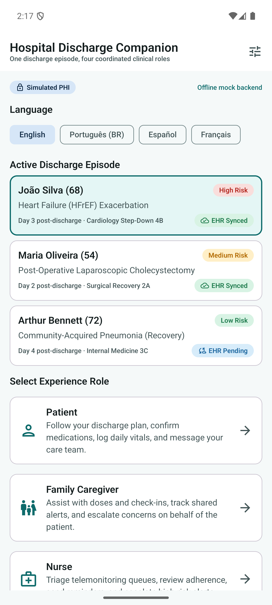 | 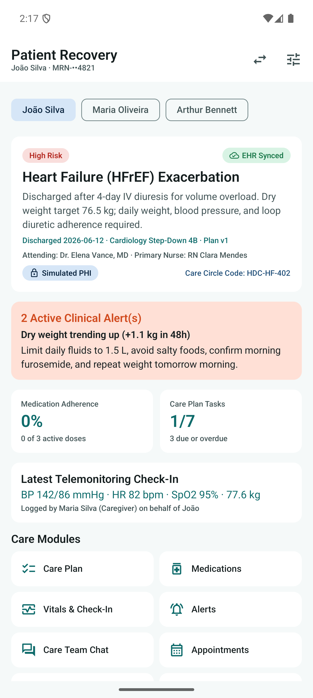 | 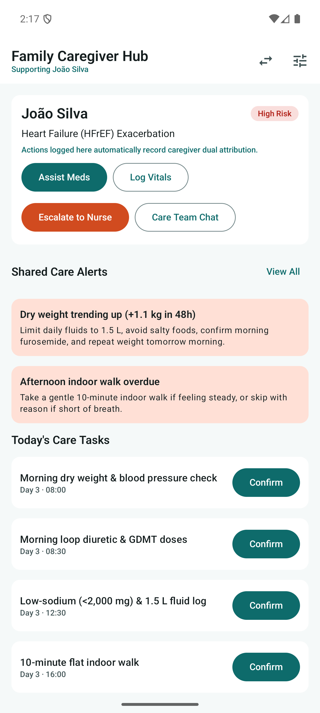 |

| Nurse Triage Hub | Physician Escalations |
| :---: | :---: |
| 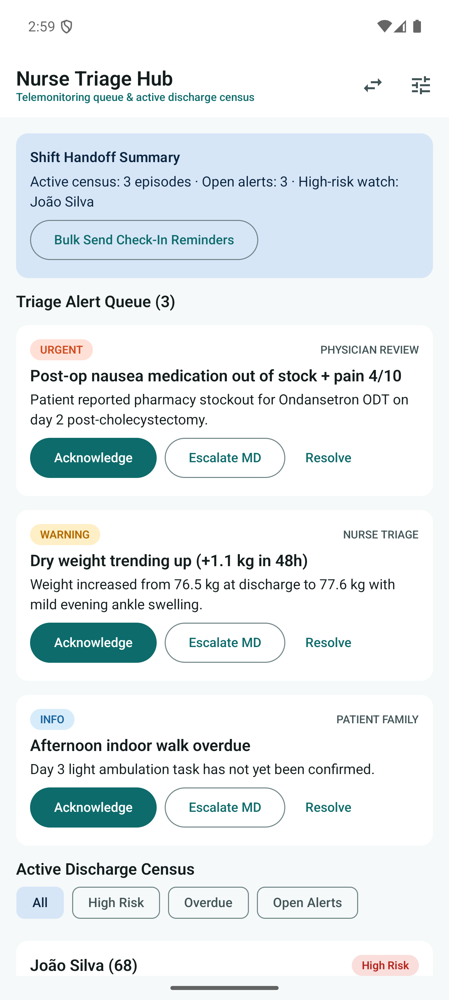 | 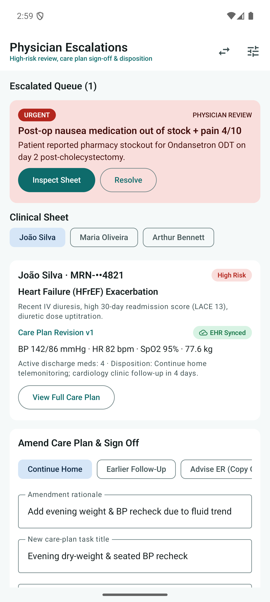 |

### Clinical Coordination Modules

| Post-Discharge Care Plan | Discharge Medications | Telemonitoring & Vitals |
| :---: | :---: | :---: |
| 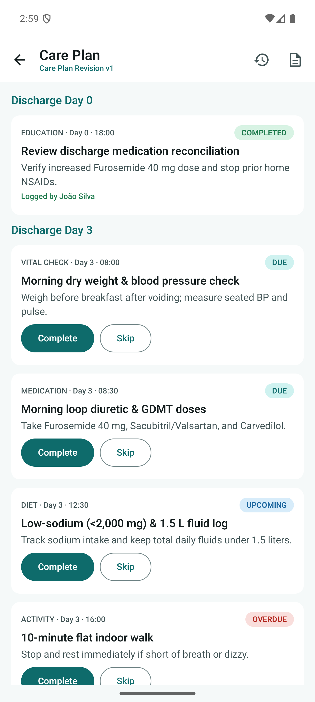 | 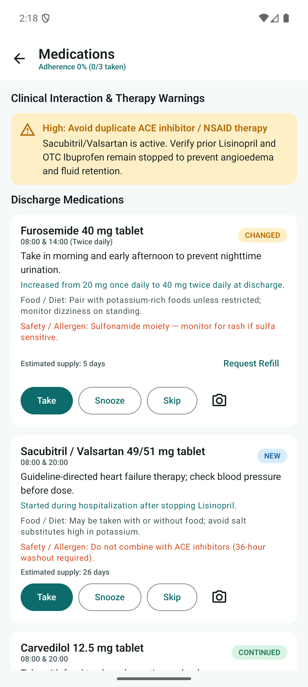 | 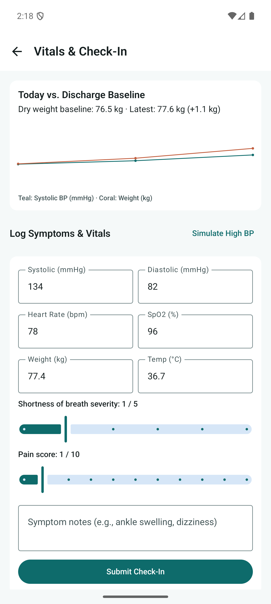 |

| Clinical Alerts & Audit Trail | Care Team Chat | Follow-Up Appointments |
| :---: | :---: | :---: |
| 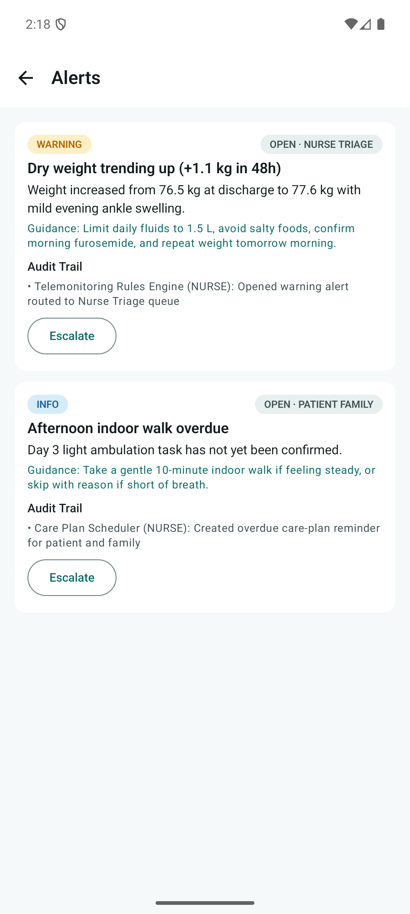 | 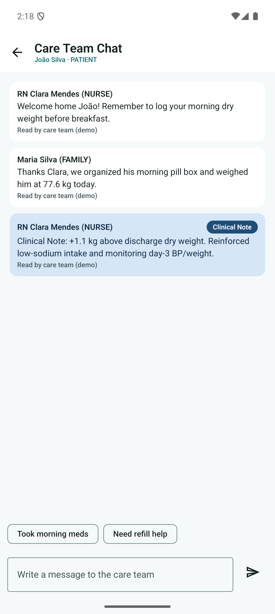 | 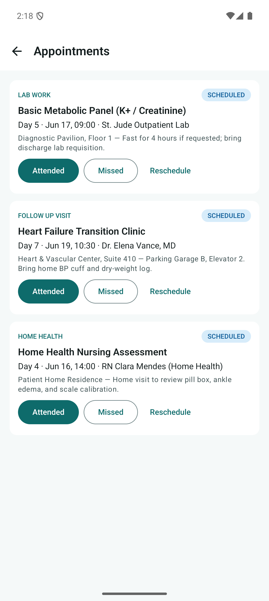 |

| Patient Education & Teach-Back | Mock FHIR / EHR Sync | Demo Controls, Notifications & About |
| :---: | :---: | :---: |
| 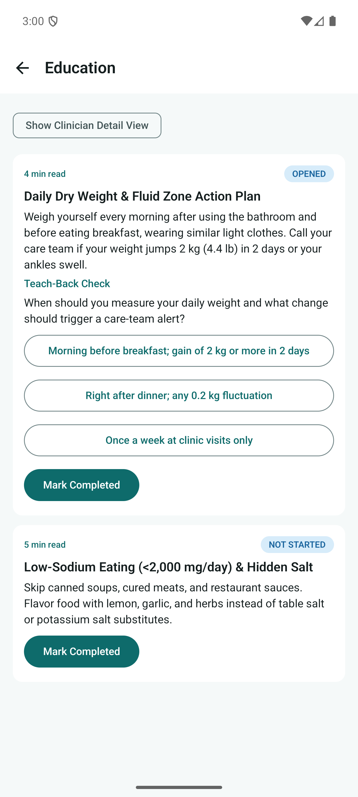 | 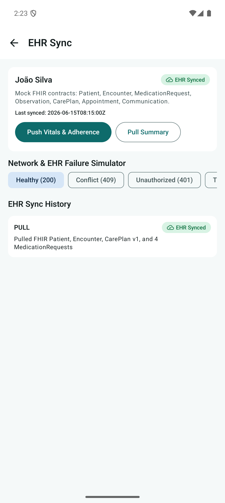 | 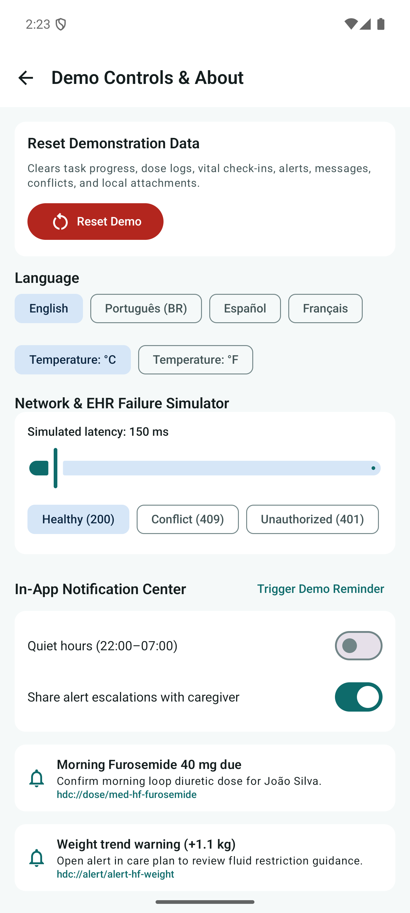 |

---

## Feature Coverage (Phase 1)

- **Onboarding & Seeded Discharge Episodes:** 3 realistic seeded episodes — **Heart Failure (HFrEF)** (High Risk), **Post-Operative Laparoscopic Cholecystectomy** (Medium Risk), and **Community-Acquired Pneumonia** (Low Risk) — with discharge summary snapshot, care team metadata, readmission risk tier, simulated PHI teaching banner, and demo care-circle invite codes.
- **Post-Discharge Care Plan:** Day-by-day grouped timeline across medication, vital check, wound care, diet, activity, education, lab, and appointment tasks; complete or skip with reason; clinician task reopen; physician care-plan revision history; on-device plain-text summary export; red-flag education cards.
- **Medication Management:** Discharge reconciliation badges (`NEW`, `CHANGED`, `CONTINUED`, `STOPPED`), drug-interaction and allergen alerts, Take / Snooze / Skip dose actions with idempotency keys, caregiver dual attribution (`Maria Silva on behalf of João`), refill / out-of-stock resolution, mock pill-box photo attachment, and adherence percentage.
- **Telemonitoring & Check-Ins:** Vitals entry with explicit clinical units (`mmHg`, `bpm`, `%`, `kg`, `°C`/`°F`), device-range validation, symptom severity sliders, Compose Canvas multi-day BP & dry-weight trend chart, today-vs-baseline comparison, one-tap abnormal BP demo preset, and Phase 2 Bluetooth wearable stub.
- **Clinical Alerts & Escalation Ladder:** Automated rules engine (`EvaluateAlertRulesUseCase`) evaluating vitals, dry-weight gain, red-flag symptoms, missed doses, missed appointments, and HTTP 409 EHR conflicts; acknowledge, snooze, resolve, and escalate (`Patient/Family → Nurse Triage → Physician Review → Advise ER copy-only`) with full audit trail.
- **Care Team Messaging & Appointments:** Episode-scoped thread with role labels, clinician-only Clinical Note toggle, quick-reply templates, urgent alert banner, mock read receipts; follow-up visits/labs/imaging/home health with attended (auto-adds post-visit task to care plan), missed (triggers alert), and reschedule request/nurse approval flow.
- **Education & Teach-Back:** Plain-language guidance plus clinician detail toggle, progress tracking, and interactive teach-back comprehension checks.
- **Nurse & Physician Workstations:** Active discharge census with risk/overdue/alert filters, triage queue, bulk check-in reminders, shift handoff summary; noise-reduced physician escalated queue, clinical sheet, disposition selector, and versioned care-plan amendment sign-off.
- **Mock FHIR / EHR Sync & Demo Platform:** Pull discharge summary / push observations, simulated latency & failure modes (`200`, `409 Conflict`, `401 Unauthorized`, `Timeout`, `Offline`), interactive conflict resolution UI, in-app notification center, quiet hours & caregiver preferences, `hdc://` deep links, full demo reset, and live presentation script.

---

## Architecture & Tech Stack

- **UI:** Kotlin 2.2, Jetpack Compose, Material 3, Material Icons Extended, Edge-to-Edge `AppCompatActivity`.
- **Navigation & Deep Links:** Typed Navigation Compose (`kotlinx.serialization`) + `hdc://` deep links (`hdc://episode/{id}`, `hdc://alert/{id}`, `hdc://dose/{id}`).
- **State & Architecture:** Unidirectional Data Flow (`StateFlow<UiState>`, `collectAsStateWithLifecycle`) following `Compose Screen → ViewModel → Repository → DataSource → MockApi`.
- **DI & Persistence:** Hilt (`@HiltAndroidApp`, `@AndroidEntryPoint`, KSP) for swapping Phase 1 mock data sources with Phase 2 REST/FHIR adapters; Jetpack DataStore Preferences for persisting active role, selected episode, locale, temperature unit, and notification preferences.
- **Localization (4 Locales):** English (`values/`), Brazilian Portuguese (`values-pt-rBR/`), Spanish (`values-es/`), and French (`values-fr/`), verified by `StringResourceParityTest` plus localized clinical seed overlays in `LocalizedClinicalPack`.
- **Testing:** JUnit 4, Google Truth, `kotlinx-coroutines-test` with deterministic `ClinicalClock` and `IdGenerator` doubles.

```text
app/src/main/java/com/hospitaldischargecompanion/
├── core/
│   ├── alerts/         # Alert models, escalation ladder, EvaluateAlertRulesUseCase, MockAlertApi
│   ├── appointments/   # Follow-up visits, reschedule approval, post-visit auto tasks
│   ├── carecircle/     # Caregiver invite codes, permissions, dual attribution
│   ├── demo/           # UserRole, DomainError, DemoNetworkSimulator, DataStore session, MockClinicalStore
│   ├── di/             # Hilt bindings modules per capability
│   ├── discharge/      # DischargeEpisode, CarePlan timeline, versioning, export
│   ├── education/      # Diagnosis-specific modules & teach-back quizzes
│   ├── ehr/            # Mock FHIR DTOs, sync status, 409 conflict reconciliation
│   ├── i18n/           # AppCompatDelegate LocaleManager & LocalizedClinicalPack
│   ├── medication/     # Reconciliation, dose logs, idempotency, refills, pill-box stub
│   ├── messaging/      # Episode threads, clinical notes, quick-reply templates
│   ├── navigation/     # Typed HdcRoutes, HdcNavHost, DeepLinkParser
│   ├── notifications/  # In-app notification center & demo local reminders
│   ├── telemonitor/    # Vitals, baselines, range validation, wearable Phase 2 stub
│   └── ui/             # Material 3 HdcTheme & shared clinical components
└── feature/            # Role hubs (profile, patient, family, nurse, physician) & clinical screens
```

---

## Building, Testing & Capturing Screenshots

### Prerequisites
- JDK 17+ (or Android Studio bundled JDK)
- Android SDK with API 36 (`compileSdk = 36`, `targetSdk = 36`, `minSdk = 26`)

### Commands

```bash
# Build debug APK
./gradlew assembleDebug

# Run all JVM unit tests (repositories, ViewModels, 4-role clinical loop, 4-locale parity, deep links)
./gradlew testDebugUnitTest

# Run Android Lint checks
./gradlew lintDebug

# Capture all 14 screenshots from a running emulator or connected device
./scripts/capture_screenshots.sh
```

---

## Live Presentation Script (5–7 Minutes)

1. **Patient Role:** Launch the **Heart Failure (HFrEF)** episode (`João Silva`), open **Medications** to confirm morning Furosemide, then open **Vitals & Check-In**, tap **Simulate High BP** (`172/104 mmHg`, `78.8 kg`), and submit.
2. **Alert & Family Role:** Observe the clinical alerts triggered automatically. Switch to **Family Caregiver**, review the shared alert guidance, and tap **Escalate to Nurse**.
3. **Nurse Triage Hub:** Switch to **Nurse**, inspect the live **Triage Alert Queue** and **Active Discharge Census**, send a **Recheck + Note**, and tap **Escalate MD**.
4. **Physician Escalations:** Switch to **Physician**, open João Silva's **Clinical Sheet**, select a disposition, and tap **Sign Off New Care Plan Revision** (creating Care Plan **v2** with an evening dry-weight check).
5. **EHR Sync Conflict & Recovery:** Open **EHR Sync**, select **Conflict (409)** in the simulator, tap **Push Vitals & Adherence**, reconcile the conflict by keeping local home data, and observe the status return to **EHR Synced**.
6. **Live Multi-Language Switch & Reset:** Switch language **English → Português (BR) / Español / Français** without leaving the episode, then open **Demo Controls & About** to reset the demo cleanly for the next walkthrough.
